# Vendor Bill Capture with AI for Odoo 19

[](LICENSE)


Photograph or upload a vendor bill, let an AI provider read it, review the proposal, **post it yourself**.

`account_bill_capture` turns a photo or PDF into a **draft vendor bill** with supplier, header and every position
filled in as a *proposal*, based on the history of the supplier and on your existing taxes, products and accounts.
It warns about what looks wrong (sum, supplier, tax, duplicate, selling price) and it **never posts, pays or mails
anything by itself**.

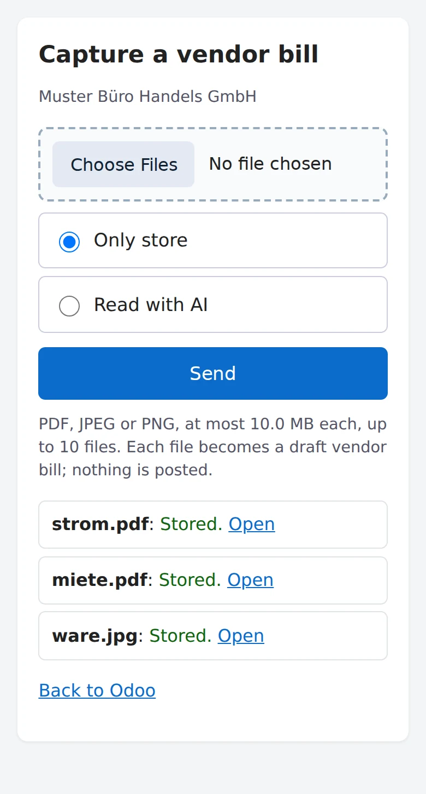

## Highlights

* **Capture** on the phone (`/bill-capture`, no JavaScript framework) or through the mail alias of the purchase journal.
* **Preview** of the document next to the draft (the standard Odoo attachment preview).
* **One provider per document.** Anthropic, OpenAI-compatible services, Google Gemini or a server of your own.
* **Privacy switch.** External providers only receive invoices when you allow it on the provider (default: off).
* **Operating mode per company:** Off, Manual (button) or Automatic (background job that only fills drafts).
* **Plausibility checks** and a list *Bills to review*.
* **Vendor prices** on the product with undo, and a **selling price warning** with a wizard.
* **Log** of every reading. German and English.

## Screenshots

All screenshots show invented demo data (fictitious suppliers, numbers and a local test provider).

| | |
|---|---|
| 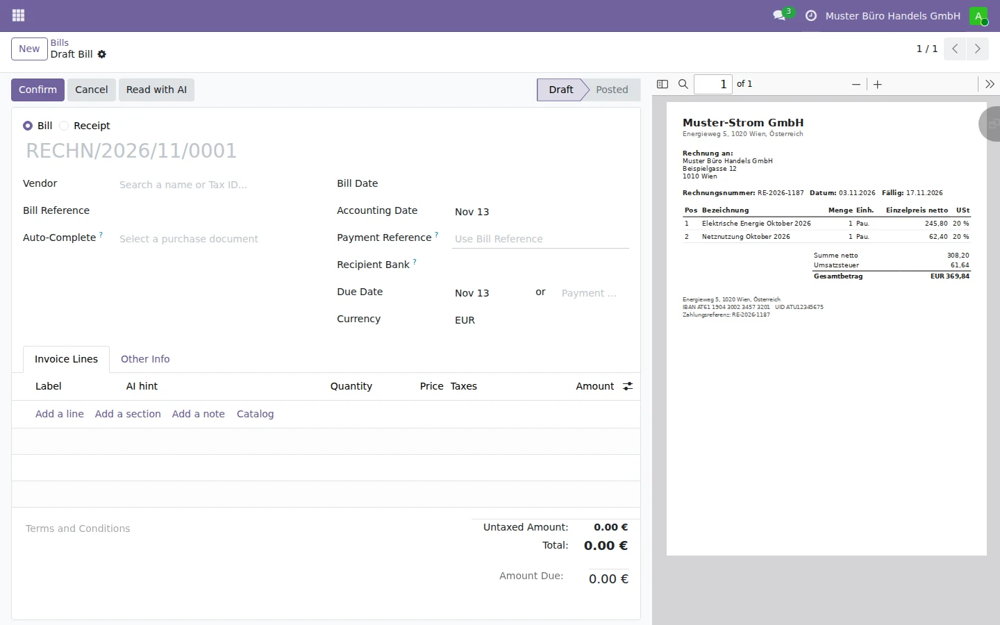 | 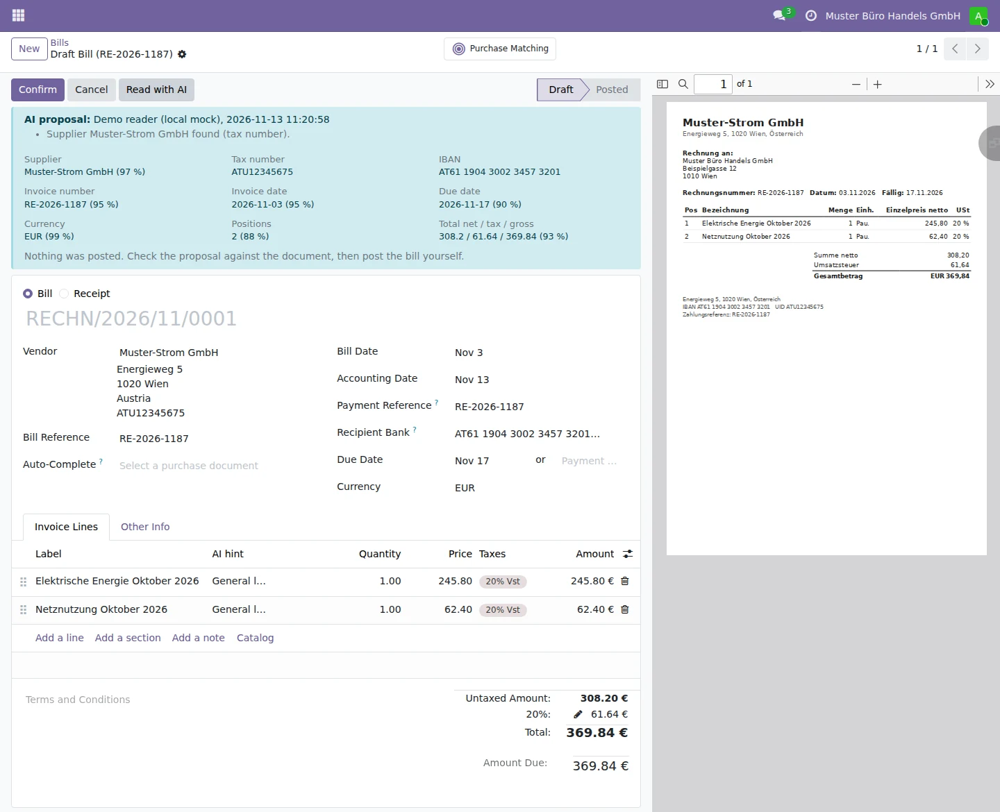 |
| Draft bill with the document on the right. | Proposal after *Read with AI*: supplier found by tax number, positions with account and tax from the history. |
| 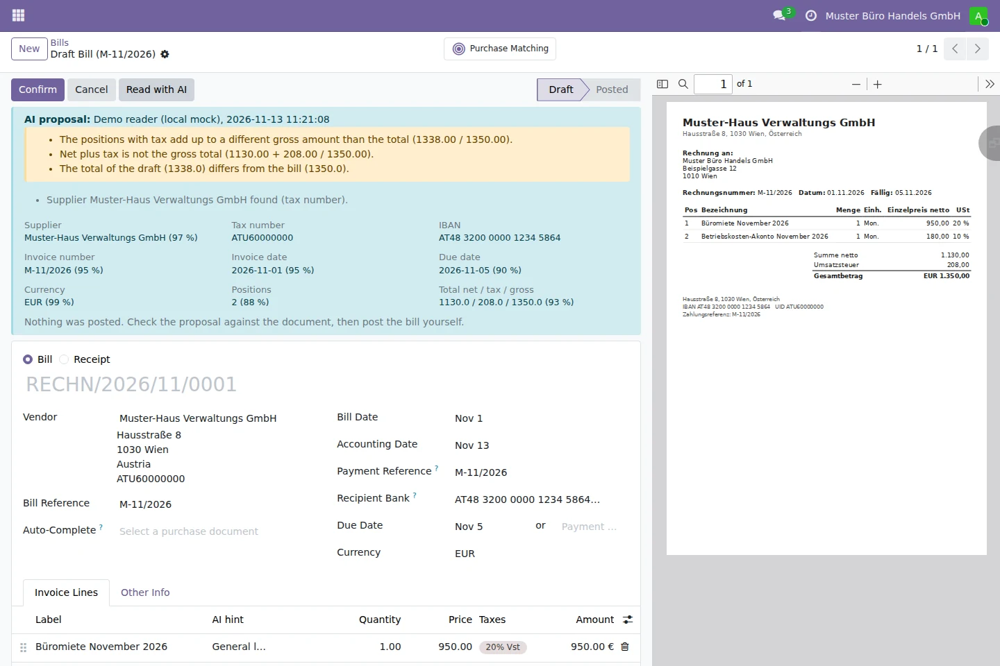 | 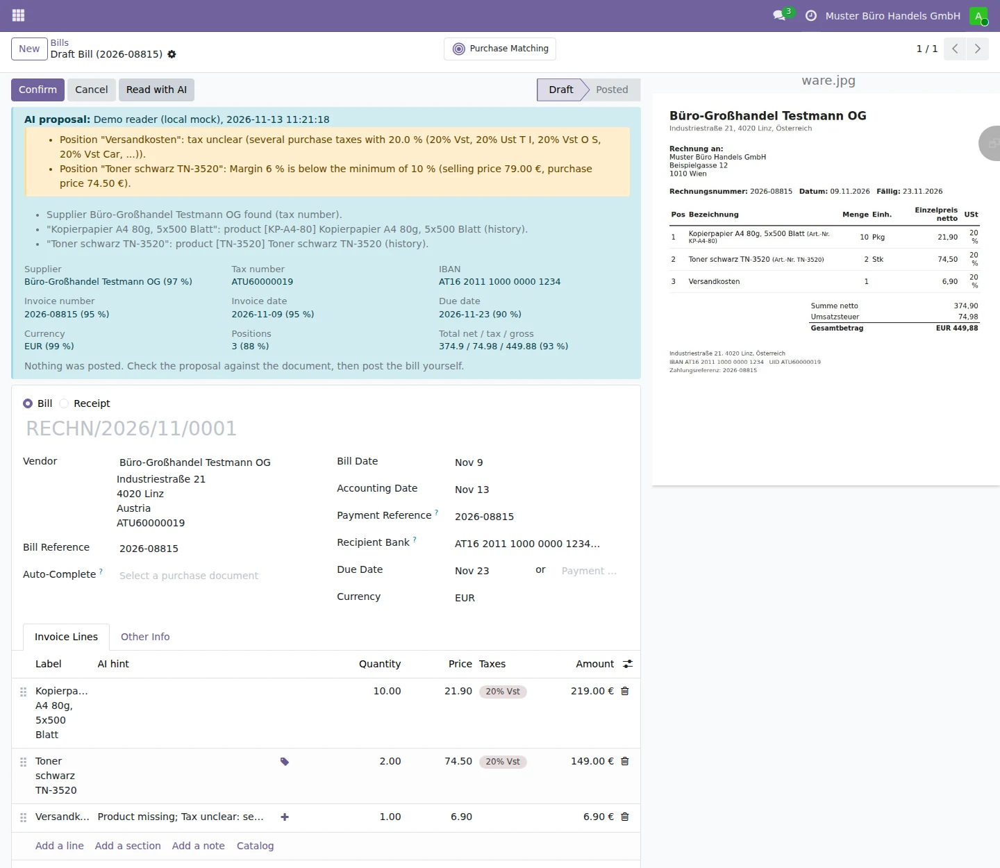 |
| The positions do not add up to the total on the bill. | A new purchase price leaves a margin below the minimum; unclear tax on a position. |
| 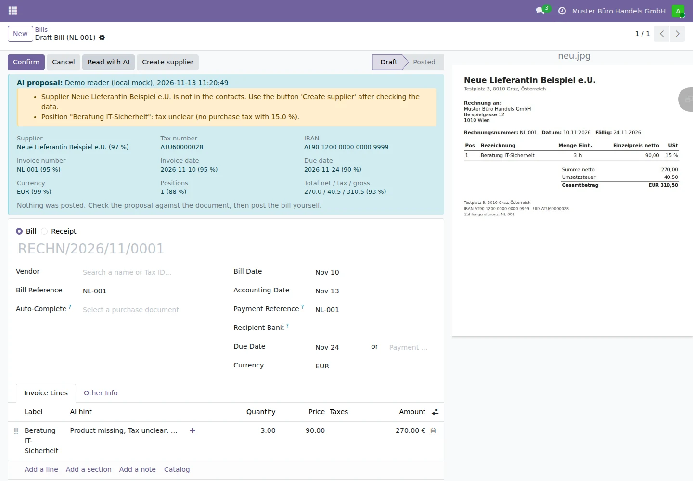 | 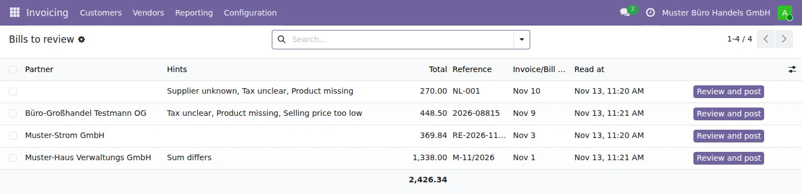 |
| Unknown supplier: *Create supplier* needs a click. A tax rate that does not exist is not invented. | List *Bills to review* with a hints column and filters. |
| 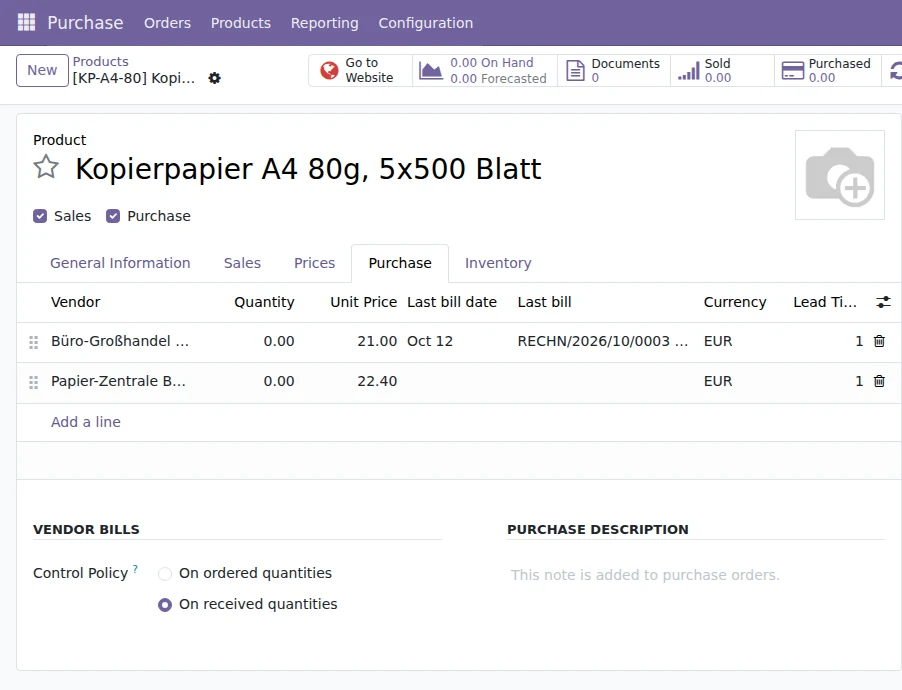 | 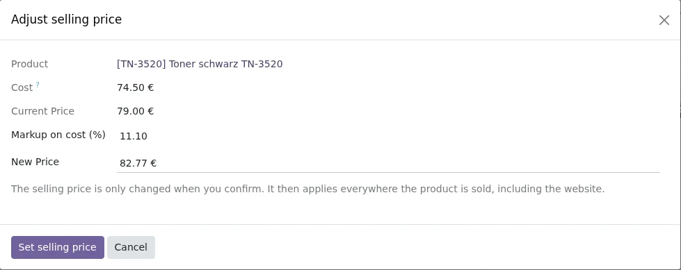 |
| Vendor list of a product with the last bill and price. | *Adjust selling price...* proposes a price; nothing changes without a confirmation. |
| 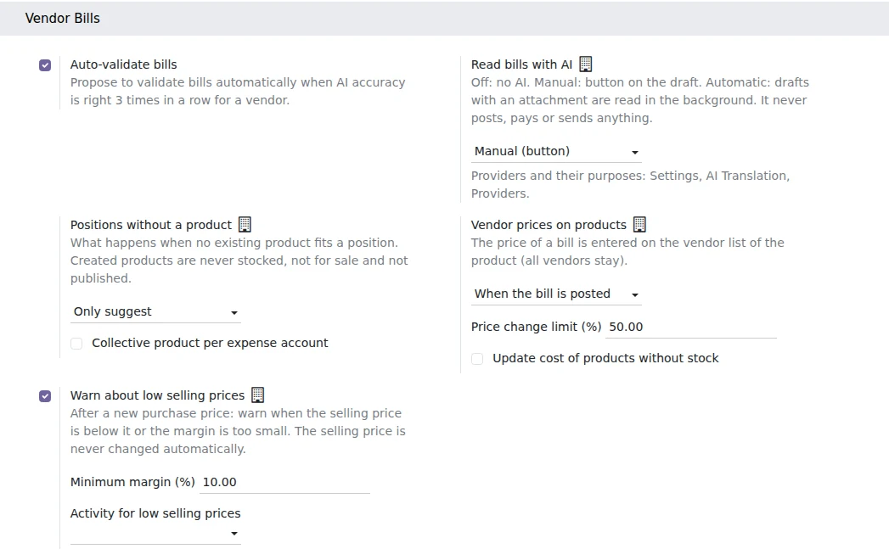 | 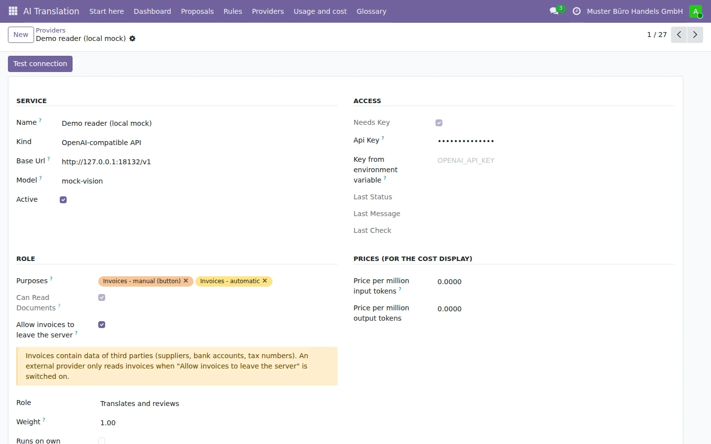 |
| Settings per company. | Provider with purposes and the privacy switch. |

## How it works

1. **Capture.** *Accounting > Vendors > Capture a bill* opens `/bill-capture`. Choose files (PDF, JPEG, PNG; HEIC is
   refused with a hint) and *Only store* or *Read with AI*. Each file becomes a draft vendor bill in the purchase
   journal with the file attached.
2. **Read.** The button *Read with AI* (accounting group only) sends the attachment to the first available provider
   with the purpose *Invoices - manual*. The answer must be JSON; it is validated strictly and never evaluated.
3. **Proposal.** Written into the draft, not posted:
   * supplier: 1. tax number, 2. IBAN, 3. fuzzy name. Nothing is created without a click (*Create supplier*);
   * header: number, date, due date, currency, payment reference, bank account (only existing ones);
   * **all positions** as invoice lines (text, quantity, unit, net unit price, discount, tax);
   * taxes only from the **existing** purchase taxes by rate; if several taxes share a rate, the history of the
     supplier decides, otherwise you get a hint instead of a guess;
   * product, account and tax preferably from the **history of the supplier**, otherwise from the vendor price list,
     the article number or the name. No product is invented.
4. **Review.** Hints are shown on the draft, in the chatter (provider and confidence per field) and in the list
   *Bills to review*. Posting stays a manual step.

### Operating mode (Settings > Accounting, per company)

| Mode | What happens |
|---|---|
| Off | No AI is used. |
| Manual | You click *Read with AI* on a draft. |
| Automatic | A background job reads new drafts that have an attachment (5 per run, time limit, at most 3 attempts) with providers that have the purpose *Invoices - automatic*. **It only fills the draft. It never posts, pays or sends anything.** A failing or paused provider leaves the draft untouched with a hint. |

### Positions without a product (per company)

*Only suggest* (default), *Create products automatically* (goods and services only; never stocked, not for sale,
not published on a website, flagged *Created by AI, to review*; an existing product is always searched first) or
*Treat as general line*. Running costs (electricity, rent, insurance ...) are always general lines.

### Vendor prices and selling price warning

The price of a bill can be written to the vendor list of the product (`product.supplierinfo`): off, when the bill is
posted (default) or immediately. A different price corrects the matching entry (vendor, variant, quantity tier,
currency, unit, discount); other vendors are never overwritten; larger changes than a limit (default 50 %) are only
suggested. The cost of stocked products is never changed. *Undo price changes* restores the previous state. After a
new purchase price a product that sells below it or under a minimum margin (default 10 %) gets a hint; the selling
price is **never** changed automatically.

## Installation

Requires Odoo 19 Community, the apps *Accounting* (`account`) and *Purchase* (`purchase`) and the module
[`ai_translation_consensus`](https://github.com/Alex0176/odoo-ai-translation-consensus) **19.0.1.3.0 or newer**,
which provides the AI providers, their *purposes* and the ability to read documents.

1. Put both modules into an addons path of your Odoo 19 and update the app list.
2. Install *Vendor Bill Capture with AI* (`account_bill_capture`).
3. *Settings > AI Translation > Providers*: open a provider that reads documents (Anthropic, Gemini, OpenAI-compatible
   with a vision model), enter the key, set the **purposes** *Invoices - manual* and/or *Invoices - automatic* and,
   for an external service, switch on **Allow invoices to leave the server**.
4. *Settings > Accounting*: choose the mode (*Off / Manual / Automatic*) per company. Start with *Manual*.
5. Users need the group *Accounting / Invoicing* (`account.group_account_invoice`).

PDF files go to Anthropic, Gemini, OpenAI and OpenRouter as files; other OpenAI-compatible services get the first
5 pages as PNG images (needs `pdftoppm` from poppler-utils).

## Privacy and security

Invoices contain data of third parties (suppliers, bank accounts, tax numbers). The document is sent to **one**
configured provider only. An external service is only used for invoices when you explicitly allow it on the
provider (*Allow invoices to leave the server*, default off); a provider on your own infrastructure needs no
switch. Check the terms of the service (retention, training, location) and your legal basis first. This is not
legal advice.

* Rights: accounting group (and administrators) only, in the controller, the buttons and the Python code.
* Provider keys are never written to the log, the chatter or the hints.
* Limits: file type decided by the content (PDF, JPEG, PNG), size limit (system parameter
  `account_bill_capture.max_file_mb`, default 10), time limit per reading, at most 3 files read per upload, field
  length limits.
* Prompt injection: the text of the invoice is data. The answer is only taken over as validated data and cannot
  trigger an action; unknown keys are dropped.

## Limits

* No OCR of its own; quality depends on the provider. **Always compare the proposal with the document.**
* The tax is only proposed from rates of existing purchase taxes. Reverse charge, mixed rates and other special
  cases are left to the reviewer; no country specific rules are built in.
* The unit text of an invoice is only used when it equals the name of a unit of measure.
* With capture switched on, *Bill Date* is not required on the draft form (otherwise Odoo blocks every header
  button, including *Read with AI*, until a date is typed). Posting still needs the date.

## Hook for later work (not implemented)

A bank statement line could offer *Create bill*. Hook: `account.move._bill_capture_store(filename, raw, ai=False)`
creates the draft with the attachment; a later module only has to pass the partner and amount of the statement
line into the draft and call `_bill_ai_run("invoice_manual", "manual")`.

## Tests

```
odoo-bin -d <empty test db> -i account,purchase,l10n_at,ai_translation_consensus,account_bill_capture \
         --test-enable --test-tags /account_bill_capture --stop-after-init --workers=0
```

The tests use a scripted provider; no network and no external AI service is called.

## Contributing, license

Issues and pull requests are welcome. Translations: `account_bill_capture/i18n/` (add new terms to the `.po` **and**
the `.pot`). License: [AGPL-3](LICENSE). Copyright 2026 Biricon IT Services GmbH.
